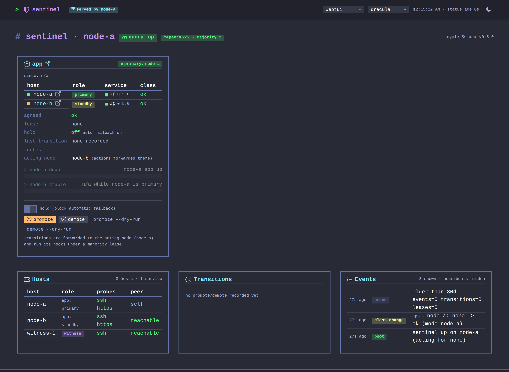

# sentinel

[](https://github.com/rojosinalma/sentinel/actions/workflows/run-tests.yml)
[](https://github.com/rojosinalma/sentinel/actions/workflows/publish-image.yml)
[](https://github.com/rojosinalma/sentinel/releases)
[](LICENSE)



Majority-vote failover for self-hosted services: one small Ruby process per host that probes,
agrees on who is primary, takes a lease and runs your promote/demote scripts.

Every node probes every host (service health URL, TCP ports, ICMP), nodes exchange their views,
and a host counts as down only when a majority of them agree. Only the service's standby node
acts: after the configured delay it takes a 30 s majority lease from its peers and runs the
service's `promote` hook; once the primary is healthy and stable again it runs `demote` to hand
back. Cooldowns, retries, flap damping and a manual hold keep it from ping-ponging, and every
probe change, decision, lease and transition lands in SQLite, on the dashboard and in the API.
Configuration, hooks, API and operations are documented in [`docs/`](docs/).

## Requirements

- Docker 24+ with Compose v2 on every voter (the image is `ghcr.io/rojosinalma/sentinel`, amd64
  and arm64), or Ruby 3.4+ with Bundler 2.6+ to run it bare.
- An **odd number of voters, at least 3** (3, 5, 7): members that can be primary or standby, plus
  witnesses that only vote. Each voter reaches the others on the cluster port (4197 by default).
- Each service you fail over: a health URL on each host that serves it, and four hook scripts
  (`promote`, `demote`, `health`, `replicate`) that know how to move it — start from
  [`hooks/_example`](hooks/_example).
- Only the **acting node** (a service's standby) needs what its hooks use: typically the docker
  socket, an ssh client with a key to the primary (OpenSSH 8+) and the service's data directories.
  Voters and witnesses need none of that.
- Optional: a Discord webhook or an Apprise endpoint for notifications.

## Installation

```sh
git clone https://github.com/rojosinalma/sentinel.git && cd sentinel
cp config/cluster.example.yml config/cluster.yml   # your hosts, witnesses and services
cp .env.example .env                                # set NODE_NAME to this host's key
mkdir -p data                                       # state + sqlite; owned by you, not root
docker compose up -d
```

Repeat on every voter with its own `NODE_NAME`. `config/cluster.yml` and `hooks/` are
bind-mounted from the checkout and must be identical on every node; the container runs as uid
1000 (`APP_UID`/`APP_GID` build args), so `data/` must be writable by it. [compose.yaml](compose.yaml)
is a plain member or witness; the acting node starts from
[examples/acting-node/compose.yaml](examples/acting-node/compose.yaml) and adds the mounts its
hooks need.

## Usage

Open the dashboard on `http://<host>:4197/` or ask any node for the cluster view:

```sh
curl -s http://<host>:4197/api/v1/status | jq .
```

It lists every host's probes and agreed class, the quorum, the current lease and which node is
primary for each service. Hold, promote and demote are buttons on the dashboard and the
`/api/hold`, `/api/promote` and `/api/demote` endpoints; `bin/sentinel once` prints one probe
cycle from the CLI.
[docs/configuration.md](docs/configuration.md) covers every key, [docs/hooks.md](docs/hooks.md)
how to write the hooks for your service, [docs/api.md](docs/api.md) the HTTP and MCP surface and
[docs/operations.md](docs/operations.md) day-to-day use.

## Development

```sh
bundle install
cp config/cluster.example.yml config/cluster.yml && cp .env.example .env
RACK_ENV=development bin/sentinel serve     # code reloads on the next request
bundle exec rake test                       # minitest, no network
```

See [CONTRIBUTING.md](CONTRIBUTING.md) for layout, style, the documentation map and how a release
is cut.

## License

[AGPL-3.0](LICENSE) — Copyright (C) 2026 rojosinalma.
